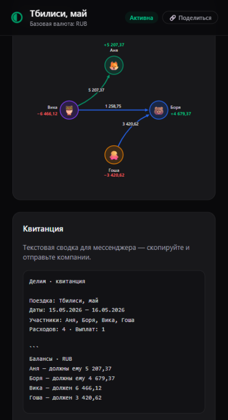
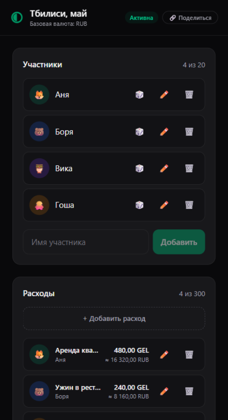
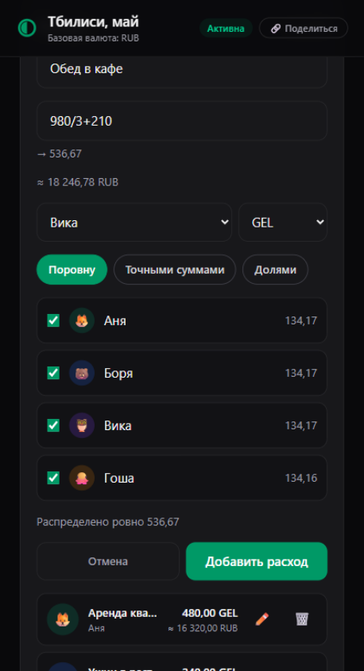
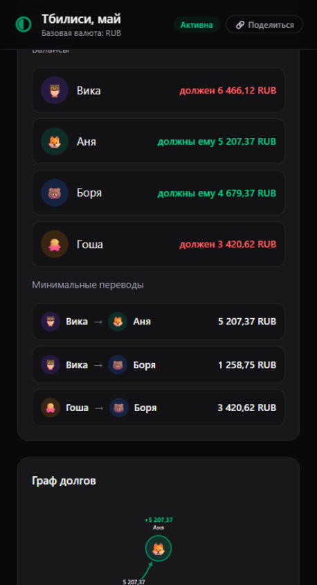
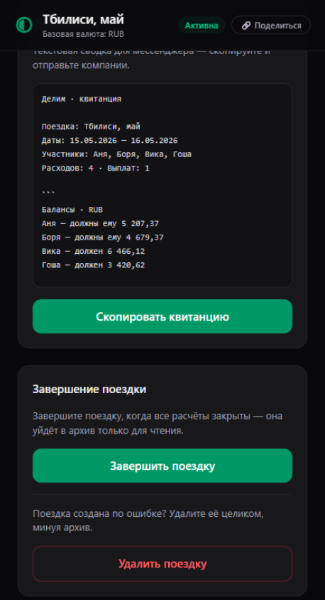
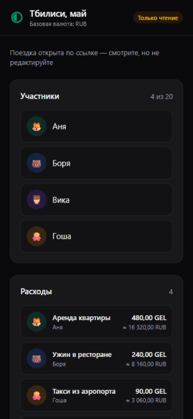

# Делим

  

<h1 align="center">Делим</h1>

  Чеки на компанию — в минимальные переводы за минуту. 
  <strong>Без регистрации. Без сервера. Без сети.</strong>

  
  
  
  
  

---

После совместных выходных или путешествия сводить долги вручную — самое неприятное
в воспоминаниях о поездке. «Делим» делает это за вас: раскидайте чеки — приложение
скажет, **кто, кому и сколько должен переводить**, чтобы все рассчитались за
минимальное число переводов.

## Как это работает

| 1 · Создайте поездку | 2 · Раскидайте чеки |
|:---:|:---:|
|  |  |
| Участники с цветами и эмодзи, базовая валюта, курсы — всё локально | Сумма — хоть выражением `980/3+210`, сплит — поровну, точными суммами или долями («не пил, но ел») |

| 3 · Смотрите сведение | 4 · Отправьте квитанцию |
|:---:|:---:|
|  |  |
| Балансы каждого и **минимальные переводы** — без лишних кругов денег | Текстовая сводка для мессенджера — одним тапом в буфер |

А граф долгов в начале страницы показывает всю картину: кто кому должен и сколько.

## 🔗 Ссылка — это и есть поездка

Фишка, ради которой всё затевалось: **вся поездка сжимается в саму ссылку**.

Организатор нажимает «Поделиться» — и получает ссылку, внутри хэша которой лежит
вся поездка: участники, чеки, валюты, выплаты. Она открывается у любого, кто её
получил в мессенджере, — как обычная веб-страница:

  

- Никаких приглашений, аккаунтов и «установите приложение» — ссылка открывается
  в любом браузере.
- Никакого сервера: данные живут в ссылке и на вашем устройстве.
- Четыре участника, четыре чека, две валюты и выплата — это **~830 символов**
  ссылки. Целая поездка помещается в одно сообщение.
- Зритель видит поездку только для чтения — испортить расклад случайно нельзя.

## Почему это честная математика

- **Минимальные переводы.** Жадный алгоритм даёт не больше n−1 переводов, а для
  компаний до 12 человек — точный поиск минимума. Никаких «А должен Б, Б должен В,
  В должен А» по кругу.
- **Копейка к копейке.** Все суммы — целые минорные единицы, курсы — точные дроби,
  остатки от деления распределяются честно. Сумма балансов всегда ровно ноль.
- **Валюты с ручными курсами.** Платили в лари, считаете в рублях. Правка курса
  пересчитывает всю поездку — задним числом, мгновенно.
- **Выплаты любой суммой.** Частичный возврат — и сведение пересчитывается
  на лету, лишние переводы исчезают с графа.

## Приватность по построению

Приложение не имеет бэкенда: **данные не покидают устройство**, кроме случая,
когда вы сами отправляете ссылку. Ни аналитики, ни трекеров, ни сетевых запросов
вообще — поездка сработает в самолёте, в горах и в роуминге.

## Попробовать

Откройте [**l2cri.github.io/delim**](https://l2cri.github.io/delim/) в браузере
на телефоне или компьютере. Это PWA: добавьте на домашний экран — и приложение
работает офлайн после первого открытия.

Тёмная и светлая темы подстраиваются под системные настройки.

## Под капотом

Vite + Vue 3 + TypeScript, Tailwind, чистое ядро расчётов без зависимостей от
фреймворка (Vitest + fast-check: property-based и exhaustive-тесты алгоритма
сведения), lz-string для ссылок, vite-plugin-pwa. Без сервера, без Pinia,
без роутера.

Подробности — в [docs/ABOUT.md](docs/ABOUT.md): спецификация, архитектура,
ADR и процесс разработки.
